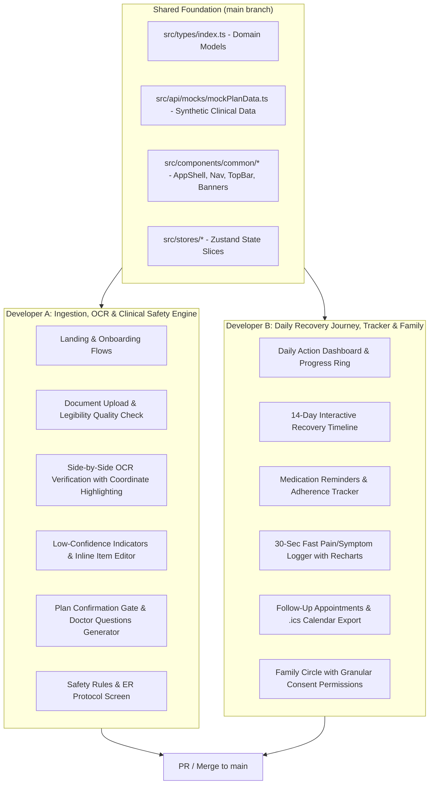

# Recovery Compass — Production-Quality Hackathon MVP

> **Recovery Compass** converts hospital discharge instructions into an understandable, verified, day-by-day recovery journey for patients and family caregivers.

---

## 👥 2-Person Parallel Team Architecture & Branch Strategy

To enable seamless, conflict-free collaboration on GitHub, the application is divided cleanly by domain ownership:



---

## 🛠️ Tech Stack

* **Framework**: React 18 + Vite + TypeScript (Strict Mode)
* **Styling**: Tailwind CSS + Custom Healthcare Palette & Accessible Tokens
* **Icons**: Lucide React
* **State Management**: Zustand
* **Visualizations**: Recharts (7-day Pain Trend, Checklist Completion Rate)
* **Routing**: React Router v6

---

## 🚀 Running the Project

1. **Install dependencies**:
   ```bash
   npm install
   ```

2. **Start the local dev server**:
   ```bash
   npm run dev
   ```
   Open `http://localhost:3000` in your browser.

3. **Production build**:
   ```bash
   npm run build
   ```

---

## 🧪 Hackathon Demo Mode

The application includes a deterministic synthetic clinical case for **Laparoscopic Cholecystectomy (Eleanor Vance, MRN #90284-A)**:
* Click the **"Load Demo Case"** button in the TopBar at any time to populate full mock data.
* Test the **OCR Verification Workspace** with side-by-side highlighting.
* Test the **30-Second Symptom Logger** with temperature &gt; 101.0°F or shortness of breath to see the deterministic safety evaluator trigger the high-priority safety modal.
* Test the **Follow-Up Screen** to download a valid `.ics` calendar appointment.
* Test the **Family Circle** to configure 4 granular caregiver permissions.
